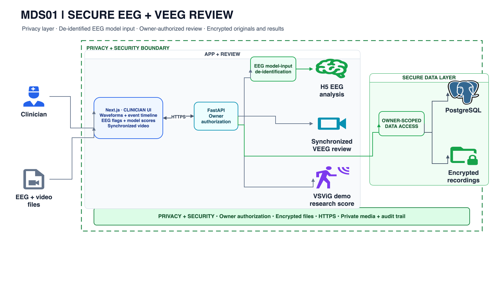

# System architecture

MDS01 is a local research prototype with a Next.js browser, a FastAPI backend,
relational metadata storage, and private encrypted file storage. The combined
EEG/VEEG review path and standalone VSViG experiment are separate workflows.

The system overview is laid out as a 16:9 presentation slide. It highlights the
main platforms, review paths, and protected storage; detailed processing and
security boundaries remain in the linked runbooks.

Edit the [system architecture in Draw.io](diagrams/system-architecture.drawio)
or inspect its [JSON source](diagrams/system-architecture.json). The
[VEEG review workflow](diagrams/veeg-review-flow.drawio) is also editable.

## VEEG workflow

The editable VEEG workflow separates combined clinical reference playback from
the standalone video-analysis path. Combined reference playback never requires
pose readiness or VSViG inference.
Generated local setup enables MDS01_CLINICAL_VIDEO_REVIEW_ENABLED for owner-only
review; a backend with no explicit value defaults to disabled. The review popup
opens only when the user asks for it. A verified clip follows the EEG source
clock through internal EEG acquisition gaps, while the waveform keeps those
gaps visible. Unmatched clips are not presented as synchronized.

## Boundaries and constraints

- Routes validate requests and return safe responses. Services own workflows;
  repositories own database queries.
- PostgreSQL stores structured state, safe metadata, and results. Recording
  binaries remain in private encrypted file storage.
- Background work runs inside the API process. It is suitable for this local
  prototype, but it is not a durable distributed job queue.
- Access is uploader-only. Local Compose binds to loopback; external hosting,
  HTTPS termination, institution-managed identity, key rotation, and verified
  backup recovery are separate deployment work.

For platforms, model algorithms, the API map, setup requirements, and known
limits, see the [project design](project-design.md). Operational detail remains
in the [setup](setup.md), [backend](backend.md), [frontend](frontend.md), and
[video runbook](video-detection.md).
