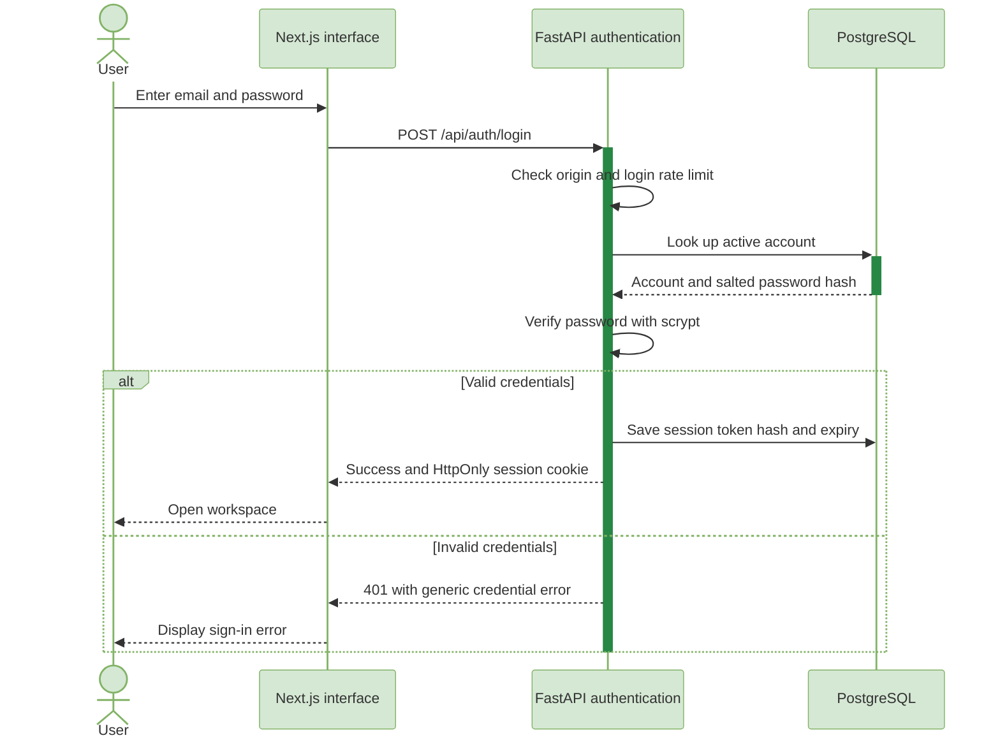
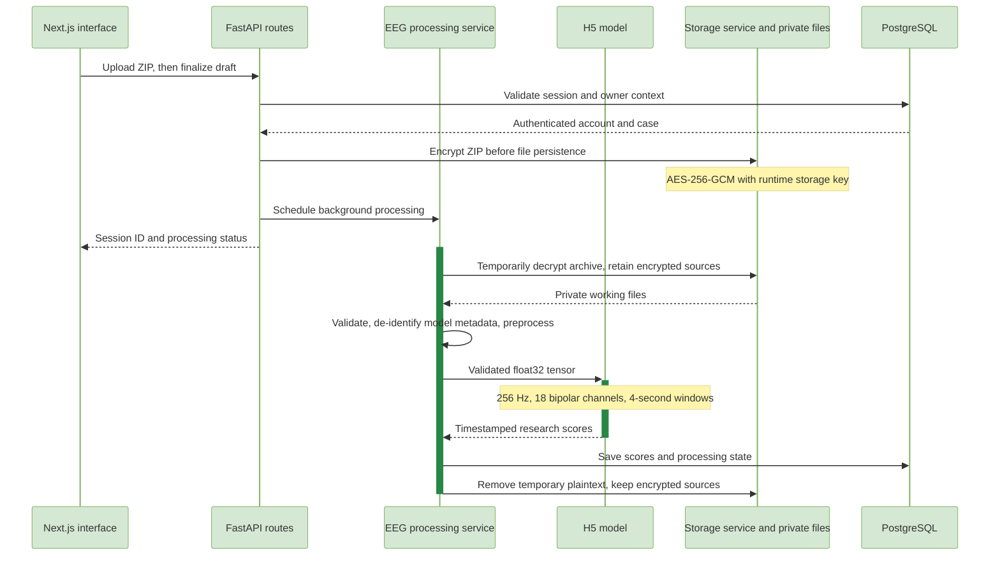
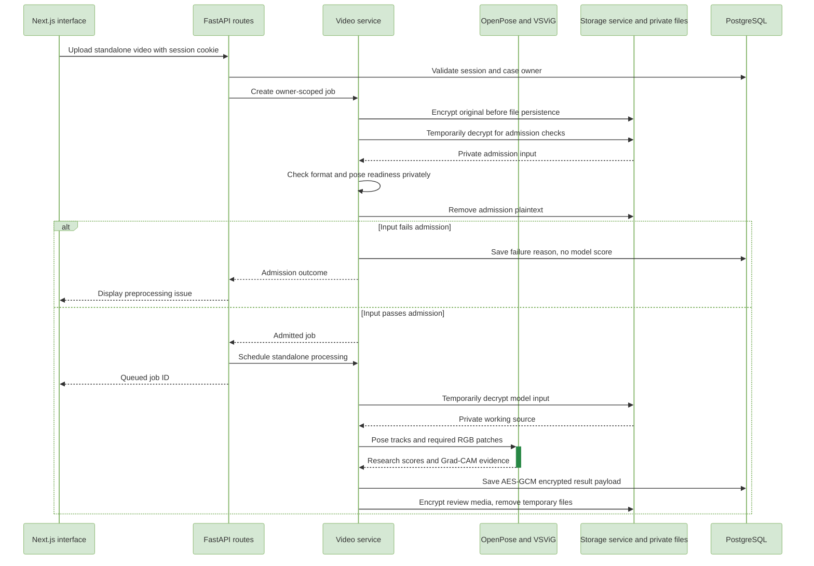
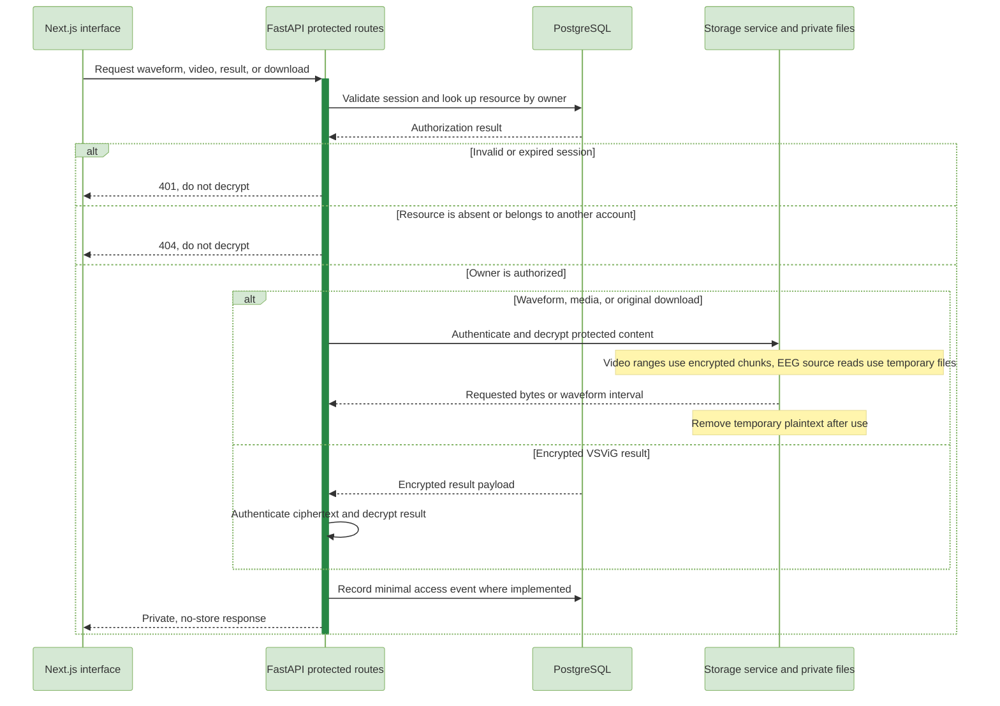

# Backend architecture and security

MDS01 is a local research prototype with a Next.js browser, a FastAPI backend,
relational metadata storage, and private encrypted file storage. The combined
EEG/VEEG review path and standalone VSViG experiment are separate workflows.

The login diagram shows local-account mode. Read each sequence from top to
bottom. Solid arrows show requests or
work; dashed arrows show replies. The [backend handover](backend-handover.md)
explains startup, and the [file map](backend-file-map.md) locates each module.

## 1. Login and session security

Passwords use **salted scrypt hashes**. Only a **SHA-256 hash** of the random
session token is persisted; the raw token goes in the browser cookie. The
cookie uses `HttpOnly` and `SameSite=Lax`; `Secure` is set for HTTPS requests.
Expired or revoked sessions cannot authorize private reads. Session expiry
does not delete retained recordings.

## 2. EEG upload, encryption, and H5 processing

H5 receives normal numeric model input. Encryption protects retained files;
the complete source waveform is kept separately for clinical review. EEG
scores are structured database rows, rather than encrypted model tensors.

## 3. Standalone video and encrypted VSViG results

New video files use independently authenticated encryption chunks. VSViG
result ciphertext is bound to its owner and job. Models operate on temporary
plaintext inputs; working frames and patches are removed after use.

## 4. Owner-authorized review and decryption

Every video-range request repeats the owner check. Private filesystem paths
are not returned to the browser. Legacy monolithic media may use a private
temporary plaintext cache; new chunked media decrypts only the required chunks.

## Where the security code lives

| Protection | Main implementation |
| --- | --- |
| Password hashing, session creation, expiry | [auth_service.py](../backend/app/services/auth_service.py) |
| Login endpoint and cookie settings | [auth.py](../backend/app/api/auth.py) |
| Authentication and write-origin checks | [security.py](../backend/app/core/security.py) |
| Owner-filtered database lookups | [repository.py](../backend/app/database/repository.py), [video_detection_repository.py](../backend/app/database/video_detection_repository.py) |
| File encryption, integrity, private temporary files | [storage_service.py](../backend/app/services/storage_service.py), [video_storage_service.py](../backend/app/services/video_storage_service.py) |
| EEG processing and cleanup | [processing_service.py](../backend/app/services/processing_service.py) |
| Video admission, encrypted results, reference preparation | [video_detection_service.py](../backend/app/services/video_detection_service.py) |
| Runtime encryption-key validation | [crypto.py](../backend/app/privacy/crypto.py) |

`MDS01_STORAGE_KEY` supplies **32 decoded bytes** through the backend runtime
environment. It is kept in ignored local configuration, outside Git and
PostgreSQL, and is never sent to the browser. AES-GCM uses fresh nonces and
authenticates encrypted content before release.

Selected patient fields, observations, synchronization anchors, and new VSViG
result payloads have application encryption. Ordinary job metadata and EEG
scores remain structured rows; this is not whole-database encryption.
New originals, review media, and results remain until owner case deletion.
Deletion removes linked rows and artifacts and is blocked while processing
is active. Audit entries avoid patient labels and request bodies.

## VEEG workflow

Combined clinical reference playback is separate from standalone video
analysis. It never requires pose readiness or VSViG inference.
Generated local setup enables MDS01_CLINICAL_VIDEO_REVIEW_ENABLED for owner-only
review; a backend with no explicit value defaults to disabled. The review popup
opens only when the user asks for it. Combined uploads encrypt and retain the
original, then acknowledge without blocking on media probing or video AI. A
restart-recoverable background worker checks the source clock and format and
refreshes matching. Compatible H.264 MP4 streams from authenticated encrypted
byte ranges. An unsupported clip is converted only after the owner opens its
popup; the encrypted original remains retained. This format preparation does
not run OpenPose or VSViG. A verified clip follows the EEG source clock, which
holds during video buffering and never gets reset by routine video time updates.
Genuine acquisition gaps stay visible, and unmatched clips are not presented as
synchronized.

## Boundaries and constraints

- Routes validate requests and return safe responses. Services own workflows;
  repositories own database queries.
- PostgreSQL stores structured state, safe metadata, and results. Recording
  binaries remain in private encrypted file storage.
- Background work runs inside the API process. It is suitable for this local
  prototype, but it is not a durable distributed job queue.
- Access is uploader-only. Local Compose binds to loopback; external hosting,
  HTTPS termination, institution-managed identity, key rotation, and verified
  backup recovery are separate deployment work.

For local startup, see [setup](setup.md). For code locations and implementation
details, see the [backend guide](backend.md), [frontend guide](frontend.md), and
[video runbook](video-detection.md).
