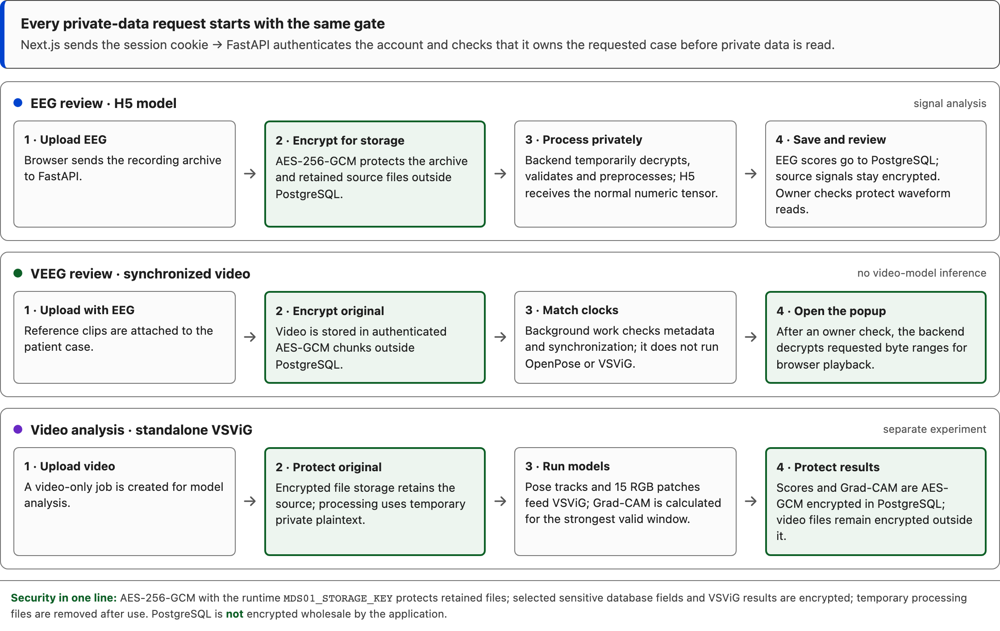

# Start here: where the data goes

If the other project documents feel like too much, read this page only. The key idea is:

> **Encryption protects saved files. Models need readable data, so the backend decrypts EEG/video into restricted temporary work files while processing, then removes those files. For video playback, it checks the owner and decrypts only the requested chunks.**

The EEG model, synchronized VEEG review, and standalone video model are three separate paths.

## First: why is there a `.env.example`?

You normally do **not** open or edit it. It is a safe template that lets the setup script create the real local settings file.

1. `node scripts/demo.mjs` runs `scripts/setup.mjs` automatically.
2. Setup copies `.env.example` to `.env` and `frontend/.env.example` to `frontend/.env.local`.
3. Setup generates local passwords and encryption keys in `.env`. That real file is ignored by Git; the example contains no real key.
4. On later runs setup keeps your existing secrets instead of replacing them.

Keep `.env.example`: `scripts/setup.mjs` reads it, so deleting it would break a fresh setup unless we first replace that template mechanism. **You do not need to change it to run the demo.**

## What happens to each upload?

### EEG recording → H5 model

1. The browser sends the EEG ZIP to FastAPI.
2. FastAPI encrypts it with **AES-256-GCM** and saves the encrypted file outside PostgreSQL.
3. The background EEG worker decrypts it into a private temporary folder so it can read the EEG. It validates the recording, removes identifying metadata, and prepares the model input.
4. H5 receives ordinary numeric EEG samples (the reviewed 256 Hz, 18-channel input), **not ciphertext**.
5. Model scores are saved in PostgreSQL. The original recording and the review waveform are saved as encrypted files. Temporary working files are cleaned up after processing.
6. When the owner opens the waveform, FastAPI checks ownership, temporarily decrypts the retained signal, reads the requested time range, deletes the temporary copy, and returns the signal with private/no-store headers.

**In short:** encrypt the upload for storage → temporarily decrypt for EEG processing → encrypt retained recording and waveform → decrypt after an owner check for review.

### EEG + reference video → synchronized VEEG review

1. FastAPI encrypts each uploaded video in authenticated AES-GCM chunks and stores it outside PostgreSQL.
2. A background task checks file and clock metadata to find a reliable EEG/video match. It does **not** run OpenPose or VSViG.
3. When the owner opens the video popup, FastAPI checks ownership and decrypts the requested video range for playback. A clip in an unsupported browser format is converted only when opened; the encrypted original is kept.
4. The video follows validated clock mappings. A clip without a reliable match can still be viewed, but it is not presented as synchronized.

### Video-only upload → experimental VSViG

1. FastAPI encrypts and retains the original video outside PostgreSQL.
2. The video worker temporarily decrypts it to extract pose tracks and 15 RGB patches, then runs VSViG. Grad-CAM is generated for supported model output.
3. The result payload (including supported Grad-CAM data) is AES-GCM encrypted in PostgreSQL. Retained video artifacts are encrypted files. Temporary plaintext is cleaned up.

This path is a separate research experiment. It is not part of synchronized EEG/video review and does not diagnose seizures.

## Where encryption is—and is not

| Data | Protection in this prototype |
| --- | --- |
| Retained EEG/video files | AES-256-GCM encrypted outside PostgreSQL |
| Selected sensitive database fields and VSViG result payload | Application-level AES-GCM encryption |
| EEG scores and routine database metadata | Stored as normal PostgreSQL values; the application does not encrypt the whole database |
| Temporary processing files | Plaintext in restricted private work folders while needed, then removed; processing is not memory-only |
| Playback and waveform responses | Owner check, then private/no-store response |
| Network traffic in the local demo | HTTP on loopback; file encryption at rest does not provide HTTPS. Configure HTTPS before network use. |

`MDS01_STORAGE_KEY` is generated into the ignored local `.env`. It is Base64 text that decodes to a 32-byte key. The backend uses it for AES-256-GCM. The local prototype has no KMS/HSM or automatic key rotation; do not expose it to a network as-is.

## Run it

1. Install Docker Desktop and Node.js 22 or newer.
2. Add the reviewed H5 files: `backend/model/best_seizure_model.h5` and `backend/model/model-contract.json` (these are local assets, not committed to Git).
3. From the repository root run:

   ```sh
   node scripts/demo.mjs
   ```

Open [the app](http://127.0.0.1:3000). The first run builds containers and initializes pinned video-model assets, so it takes longer. Stop with `docker compose down`. Avoid `docker compose down -v` unless you intend to delete the local database, encrypted files, and model volume.

## If you need to change code

| What you are changing | Start in |
| --- | --- |
| EEG upload, processing, H5 | `backend/app/api/`, `backend/app/services/processing_service.py`, `backend/app/eeg/`, `backend/app/ml/` |
| File encryption and storage | `backend/app/services/storage_service.py`, `backend/app/services/video_storage_service.py`, `backend/app/privacy/` |
| VEEG matching and playback | `backend/app/services/video_sync_service.py`, `backend/app/services/video_detection_service.py` |
| VSViG, pose, Grad-CAM | `backend/app/video_detection/` |
| Screens and browser behavior | `frontend/src/` |

<details>
<summary>Optional: open the pipeline picture and editable source</summary>



<details>
<summary>Editable diagram source</summary>

<div class="mds-handover-flow">
<style>
.mds-handover-flow{max-width:1120px;box-sizing:border-box;margin:18px auto;color:#1e1e1e}.mds-handover-flow *{box-sizing:border-box}.mds-hf-shared{padding:16px 18px;margin-bottom:14px;border:1px solid #4a4a4a;border-left:5px solid #0043ce;border-radius:8px;background:#fbfbfb}.mds-hf-shared strong{display:block;margin-bottom:4px;font-size:16px}.mds-hf-shared span{font-size:14px;line-height:1.5;color:#3f3f3f}.mds-hf-lanes{display:grid;gap:12px}.mds-hf-lane{padding:14px;border:1px solid #787878;border-radius:9px;background:#ffffff}.mds-hf-head{display:flex;align-items:center;gap:9px;margin-bottom:11px}.mds-hf-head b{font-size:15px}.mds-hf-head small{margin-left:auto;color:#565656;font-size:12px}.mds-hf-mark{width:10px;height:10px;flex:0 0 10px;border-radius:50%;background:#0043ce}.mds-hf-lane.veeg .mds-hf-mark{background:#0e6027}.mds-hf-lane.vsvig .mds-hf-mark{background:#6929c4}.mds-hf-steps{display:grid;grid-template-columns:minmax(0,1fr) 18px minmax(0,1fr) 18px minmax(0,1fr) 18px minmax(0,1fr);gap:7px;align-items:stretch}.mds-hf-step{min-height:94px;padding:11px;border:1px solid #787878;border-radius:6px;background:#fbfbfb;font-size:13px;line-height:1.4}.mds-hf-step b{display:block;margin-bottom:5px;font-size:13px}.mds-hf-step.secure{border:2px solid #0e6027;background:#edf5ef}.mds-hf-arrow{display:flex;align-items:center;justify-content:center;color:#565656;font-size:18px}.mds-hf-key{margin-top:12px;padding:10px 12px;border-top:1px solid #787878;color:#3f3f3f;font-size:12px;line-height:1.5}.mds-hf-key b{color:#0e6027}.mds-handover-flow p{margin:0}@media(max-width:760px){.mds-hf-steps{grid-template-columns:1fr;gap:6px}.mds-hf-arrow{height:16px;transform:rotate(90deg)}.mds-hf-head{flex-wrap:wrap}.mds-hf-head small{width:100%;margin-left:19px}}
</style>
<div class="mds-hf-shared"><strong>Every private-data request starts with the same gate</strong><span>Next.js sends the session cookie → FastAPI authenticates the account and checks that it owns the requested case before private data is read.</span></div>
<div class="mds-hf-lanes">
<section class="mds-hf-lane eeg"><div class="mds-hf-head"><i class="mds-hf-mark"></i><b>EEG review · H5 model</b><small>signal analysis</small></div><div class="mds-hf-steps"><div class="mds-hf-step"><b>1 · Upload EEG</b>Browser sends the recording archive to FastAPI.</div><div class="mds-hf-arrow">→</div><div class="mds-hf-step secure"><b>2 · Encrypt for storage</b>AES-256-GCM protects the archive and retained source files outside PostgreSQL.</div><div class="mds-hf-arrow">→</div><div class="mds-hf-step"><b>3 · Process privately</b>Backend temporarily decrypts, validates and preprocesses; H5 receives the normal numeric tensor.</div><div class="mds-hf-arrow">→</div><div class="mds-hf-step"><b>4 · Save and review</b>EEG scores go to PostgreSQL; source signals stay encrypted. Owner checks protect waveform reads.</div></div></section>
<section class="mds-hf-lane veeg"><div class="mds-hf-head"><i class="mds-hf-mark"></i><b>VEEG review · synchronized video</b><small>no video-model inference</small></div><div class="mds-hf-steps"><div class="mds-hf-step"><b>1 · Upload with EEG</b>Reference clips are attached to the patient case.</div><div class="mds-hf-arrow">→</div><div class="mds-hf-step secure"><b>2 · Encrypt original</b>Video is stored in authenticated AES-GCM chunks outside PostgreSQL.</div><div class="mds-hf-arrow">→</div><div class="mds-hf-step"><b>3 · Match clocks</b>Background work checks metadata and synchronization; it does not run OpenPose or VSViG.</div><div class="mds-hf-arrow">→</div><div class="mds-hf-step secure"><b>4 · Open the popup</b>After an owner check, the backend decrypts requested byte ranges for browser playback.</div></div></section>
<section class="mds-hf-lane vsvig"><div class="mds-hf-head"><i class="mds-hf-mark"></i><b>Video analysis · standalone VSViG</b><small>separate experiment</small></div><div class="mds-hf-steps"><div class="mds-hf-step"><b>1 · Upload video</b>A video-only job is created for model analysis.</div><div class="mds-hf-arrow">→</div><div class="mds-hf-step secure"><b>2 · Protect original</b>Encrypted file storage retains the source; processing uses temporary private plaintext.</div><div class="mds-hf-arrow">→</div><div class="mds-hf-step"><b>3 · Run models</b>Pose tracks and 15 RGB patches feed VSViG; Grad-CAM is calculated for the strongest valid window.</div><div class="mds-hf-arrow">→</div><div class="mds-hf-step secure"><b>4 · Protect results</b>Scores and Grad-CAM are AES-GCM encrypted in PostgreSQL; video files remain encrypted outside it.</div></div></section>
</div>
<div class="mds-hf-key"><b>Security in one line:</b> AES-256-GCM with the runtime <code>MDS01_STORAGE_KEY</code> protects retained files; selected sensitive database fields and VSViG results are encrypted; temporary processing files are removed after use. PostgreSQL is <b>not</b> encrypted wholesale by the application.</div>
</div>
</details>

</details>

More detailed setup and troubleshooting are in [setup](setup.md). Other reference pages are indexed in [docs](README.md). The H5 and VSViG outputs are research results, not diagnoses; the local prototype is not configured for institutional network deployment.
