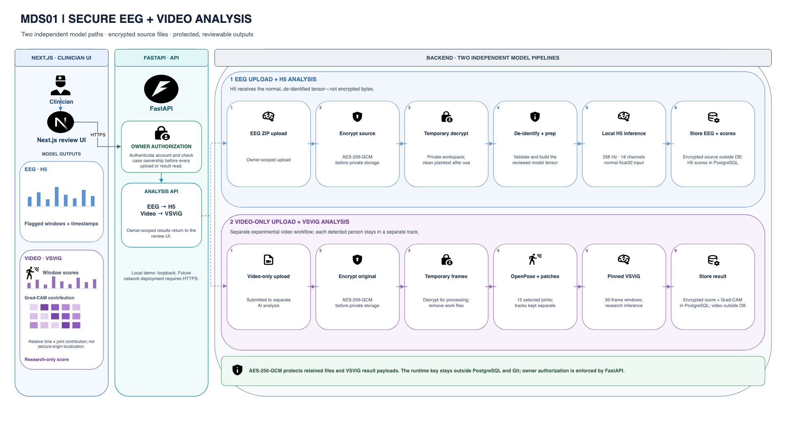

# Editable architecture diagrams

Open the `.drawio` files in [diagrams.net](https://app.diagrams.net/) to edit
their nodes, labels, groups, and connectors. The adjacent JSON files are the
generator specifications used to create them. Keep cell IDs stable when
making incremental edits.

`system-architecture-preview.svg` is the 16:9 vector architecture view
embedded in the documentation; `system-architecture-preview.png` is a
1600 × 900 slide-ready image. After changing the architecture source, rebuild
and validate the `.drawio` file, then export an SVG at Page size from
diagrams.net and refresh the PNG from that SVG. Keep the presentation diagram
focused on the major components and workflows. The VEEG workflow source is kept
editable alongside its JSON specification.

## Presentation application architecture



This 16:9 diagram is designed for a project presentation. It keeps the
Next.js UI, FastAPI API, and backend as the three main components. The backend
shows only the two model workflows: EEG preprocessing and H5 inference, plus
standalone video preprocessing and VSViG inference. Encrypted source files,
temporary processing workspaces, protected results, owner checks, score
timelines, and Grad-CAM output appear at the relevant stages. Combined clinical
VEEG playback remains implemented and is described in its runbook; it is
omitted here so the presentation can focus on the two analysis paths. Edit
[the Draw.io source](presentation-architecture.drawio) or its
[JSON specification](presentation-architecture.json). The adjacent SVG and PNG
are slide previews; refresh them after changing the editable diagram.

From the repository root, validate and rebuild with:

```sh
python3 .agents/skills/drawio-mxgraph/scripts/drawio_tool.py validate docs/diagrams/system-architecture.drawio
python3 .agents/skills/drawio-mxgraph/scripts/drawio_tool.py validate docs/diagrams/veeg-review-flow.drawio
python3 .agents/skills/drawio-mxgraph/scripts/drawio_tool.py build --spec docs/diagrams/system-architecture.json --output docs/diagrams/system-architecture.drawio --offline
python3 .agents/skills/drawio-mxgraph/scripts/drawio_tool.py build --spec docs/diagrams/veeg-review-flow.json --output docs/diagrams/veeg-review-flow.drawio --offline
python3 .agents/skills/drawio-mxgraph/scripts/drawio_tool.py build --spec docs/diagrams/presentation-architecture.json --output docs/diagrams/presentation-architecture.drawio --offline
python3 .agents/skills/drawio-mxgraph/scripts/drawio_tool.py validate docs/diagrams/presentation-architecture.drawio
frontend/node_modules/.bin/playwright screenshot --browser chromium --viewport-size='1600,900' file://$(pwd)/docs/diagrams/system-architecture-preview.svg docs/diagrams/system-architecture-preview.png
frontend/node_modules/.bin/playwright screenshot --browser chromium --viewport-size='1920,1080' file://$(pwd)/docs/diagrams/presentation-architecture-preview.svg docs/diagrams/presentation-architecture-preview.png
```

The JSON specifications and editable Draw.io sources contain no patient data.
Review diagrams against `docs/project-design.md` after architecture changes.
