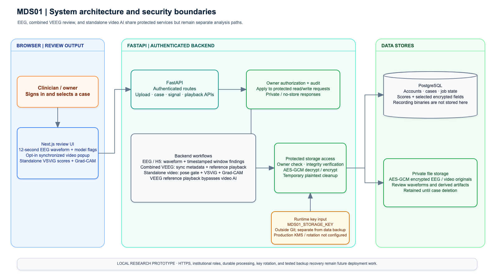
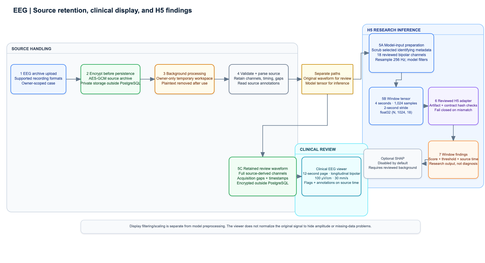
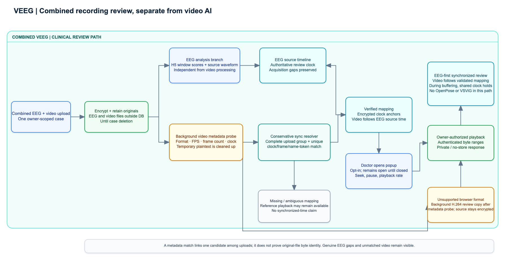
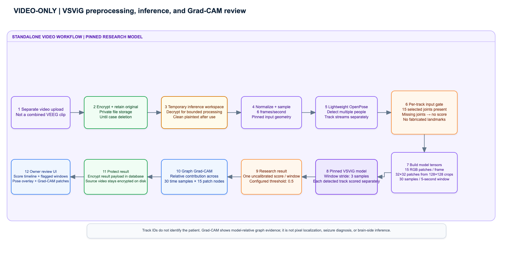
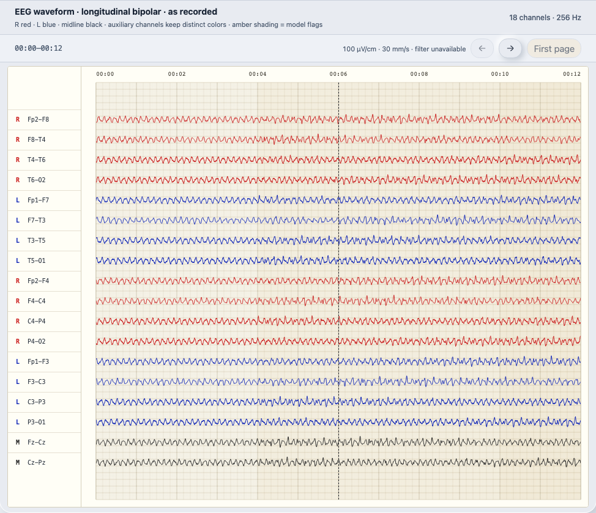
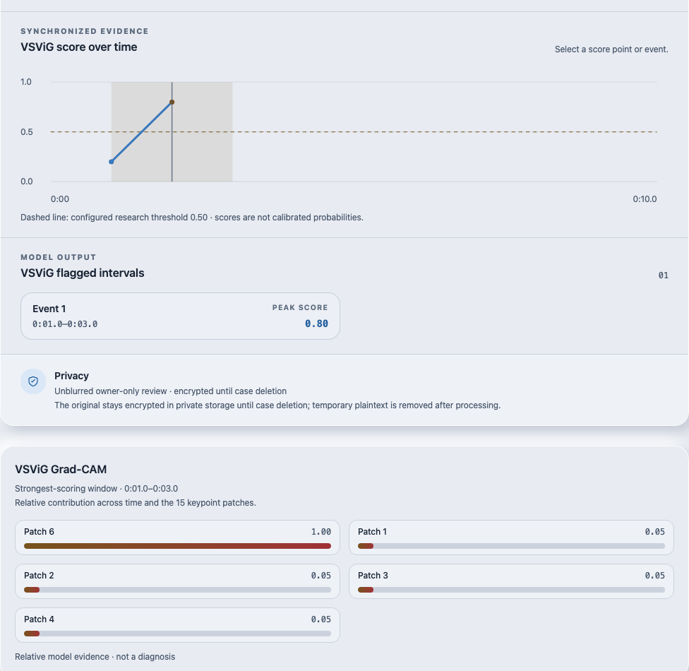

# Secure EEG/VEEG Clinical Review and Experimental Video Analysis

## MDS01 Final Project Report

**Project team:** Daffa Fariq Prasetyo (34076492); Syed Asad Ali Shah (34726918); Jeevinaash Vijayenthran (34828532); Shan Pasidu Dissanayake (31098703)

**Supervisor:** Dr Jessie Leong Shu Min

**Course:** FIT3162 / FIT3164 / FIT3189 project report

**Report date:** 28 October 2026
**Main-body word count:** approximately 2,500 words (excluding tables, references, appendices, figures, and code); maximum 3,500 words

### Authorship statement — team confirmation required

The assessment requires the team to name the member who led the initial draft
and final editing of each major section and each significant figure or
appendix. This draft does not infer individual authorship from the proposal or
meeting transcript. Before submission, replace the entries below with the
team-agreed contribution record and confirm it is accurate.

| Report component | Initial-draft lead | Final-edit lead |
|---|---|---|
| Introduction and background | To be confirmed by the team | To be confirmed by the team |
| Outcomes and requirements | To be confirmed by the team | To be confirmed by the team |
| Methodology and system diagrams | To be confirmed by the team | To be confirmed by the team |
| Project critique and conclusion | To be confirmed by the team | To be confirmed by the team |
| RTM, screenshots, and source-code appendix | To be confirmed by the team | To be confirmed by the team |

The team must assign each row to one of Daffa Fariq Prasetyo, Syed Asad Ali
Shah, Jeevinaash Vijayenthran, or Shan Pasidu Dissanayake, and verify that all
members' contributions are represented. AI assistance was used to prepare this draft from the
repository and supplied project records; the team must follow the unit's
applicable disclosure rules and verify every technical claim before submission.

### Contents

1. Introduction
2. Project background summary
3. Outcomes
4. Methodology
5. Software and project critique
6. Conclusion
7. References
8. Appendices

## 1. Introduction

MDS01 developed a local research prototype for reviewing EEG recordings,
showing related video when a defensible synchronization match exists, and
presenting separate research-model findings. Its purpose is to make recorded
evidence easier to inspect in one owner-protected workflow. The system keeps
EEG and video review available even when the experimental video model cannot
process a clip. It supports clinical review; it does not diagnose epilepsy,
confirm a seizure, or infer the side of seizure onset from movement.

The final deliverable combines a Next.js review interface, a FastAPI service,
PostgreSQL metadata and result records, encrypted file storage, an H5 EEG
inference adapter, conservative EEG/video clock mapping, and a separate VSViG
video-analysis workflow with Grad-CAM evidence. The report describes the
delivered behavior, the requirements status and test evidence, the design and
tools, and the main differences from the initial proposal. It ends with the
project critique, limitations, and the appendices required for assessment.

## 2. Project background summary

Long-term EEG and synchronized video are complementary sources for reviewing
possible seizure events: EEG records electrical activity while video can show
observable behavior. Reviewing long recordings is time-consuming, and the
source files and associated metadata are sensitive. The initial MDS01 proposal
therefore planned a privacy transformation and an explainability layer for a
larger multimodal project. During implementation, the deliverable narrowed to a
local review platform with protected source retention, EEG waveform and model
review, metadata-supported video synchronization, and a separate video-model
experiment. This shift is documented in the original proposal and the team's
October 2026 meeting record; it avoids presenting separate model outputs as a
validated fused system.

Prior work informs, but does not validate, these components. MNE-Python
demonstrates a reusable, documented approach to EEG/MEG processing and
visualisation (Gramfort et al., 2013). VSViG applies a skeleton-based
spatiotemporal vision graph to video seizure detection (Xu et al., 2023), while
Grad-CAM uses model gradients to produce relative evidence maps (Selvaraju et
al., 2017). For retained media, NIST SP 800-38D specifies Galois/Counter Mode
as authenticated encryption with associated data (Dworkin, 2007). These works
provide technical context only: MDS01 uses its pinned model contract and local
preprocessing, has not established clinical accuracy, and labels attribution
as relative model evidence rather than medical explanation.

## 3. Outcomes

### 3.1 Delivered product

The prototype has three review paths. An authenticated owner can upload an EEG
case, inspect a 12-second waveform page in a longitudinal bipolar montage, move
through the recording, and review imported source annotations beside
per-window H5 scores and threshold flags. The waveform display uses recorded
source data and preserves genuine acquisition gaps; model preprocessing is a
separate transformation and does not rewrite the retained waveform. The H5
adapter checks the local model artifact against a reviewed contract: 256 Hz,
18 bipolar channels, four-second windows, a two-second stride, and
`float32 (N, 1024, 18)` input. Scores are window-level research outputs, not a
recording-level probability or a diagnosis.

For combined EEG/video cases, the reference-video path does not invoke
OpenPose or VSViG. The application exposes an opt-in popup; verified clock
matches map video time to EEG source time, while unmatched or ambiguous clips
are not labelled as synchronized. Protected playback is owner-scoped and
supports byte ranges. The current code acknowledges a reference upload after
encrypting the original, then queues a background metadata probe. If the
browser cannot play the source, the clip remains encrypted and unconverted
until its owner opens the popup. The owner-authorized preparation request then
queues format-only conversion; this path does not invoke OpenPose or VSViG.

Standalone video analysis is independent. Compatible clips pass through the
pinned pose and input gates, produce per-window VSViG scores and, for the
strongest window, graph Grad-CAM relevance over sampled times and keypoint
patches. The model can score multiple detected tracks separately, but track
identity does not establish which person is the patient. Grad-CAM is not
pixel-level localization, a clinical cause, or seizure-origin evidence.

The storage boundary encrypts retained file contents with AES-GCM before
private-file persistence. PostgreSQL holds job state, metadata, scores, and
selected encrypted payloads; recordings remain outside the database. Owner
checks, private/no-store responses, audit events, integrity checks, temporary
plaintext cleanup, and case deletion are implemented. This is a local
prototype: it does not provide shared clinician roles, institution-managed
identity, configured production HTTPS, key rotation, or tested backup
recovery.

### 3.2 Requirements outcome

The draft RTM in Appendix A links each status to current code and test evidence.
It is a project-team proposal for review, not the supervisor-signed RTM
requested by the assessment. The strongest demonstrated areas are owner-scoped
access, encrypted file handling, source-clock mapping logic, and the
synthetic-data waveform UI. The requirements for live H5 execution and
end-to-end HUKM synchronization remain partial because they were not rerun in
this verification environment. The H5 asset and contract are present locally,
but TensorFlow is unavailable in the active Python environment and the Docker
engine was unavailable. The runbook records a prior standalone VSViG demo
inference; this report did not rerun that external model runtime.

### 3.3 Limitations and future work

The model findings are research outputs. The H5 artifact is uncalibrated, its
scores are not clinical probabilities, and no sensitivity/specificity claim
for HUKM has been established. Optional EEG SHAP generation is disabled by
default and requires a reviewed background tensor that matches the model input
profile; an unavailable explainer must not suppress valid scores. VSViG is
also uncalibrated and requires complete selected pose landmarks for every
sample in a scored window. Missing joints are rejected rather than fabricated.
Supplied low-resolution or occluded HUKM clips can therefore fail inference,
although they remain available for separate reference review.

Synchronization uses conservative clock, frame and upload-group evidence.
Existing unit tests exercise the mapping and acquisition-gap rules, but this
verification did not open a complete real HUKM case in a live browser. A
unique metadata match means one candidate among submitted files; it is not
proof of byte identity. The legacy Nicolet parser is validated against
supplied examples, not an official format specification. Browser tests use
synthetic APIs and cannot establish real-clock accuracy.

The local test pass used SQLite and test doubles in many service tests; it did
not exercise PostgreSQL, Docker networking, or an institutional deployment.
FastAPI BackgroundTasks are not a durable work queue, so process restart can
interrupt active work. Current account access is uploader-only. Production
work should add institutional identity and role policy, HTTPS, durable job
processing, reviewed key rotation and backup restoration, broader real-data
testing, and clinician evaluation. Unsupported VEEG conversion begins only
when the owner opens the clip; long or damaged source formats can still take
time to prepare.

## 4. Methodology

### 4.1 Final design rationale

The design separates user interaction, API authorization and workflow logic,
and persistence. This keeps model preprocessing away from HTTP routes and
lets clinical playback continue even when the video model rejects a clip.
Encrypted originals are retained separately from derived model inputs and
outputs. The four diagrams in Appendix D show the system boundary, EEG/H5
pipeline, combined VEEG review, and standalone VSViG/Grad-CAM flow.



**Figure 1. System architecture and security boundaries.** The Next.js client
calls the authenticated FastAPI API; services apply owner checks and route work
to EEG/H5, VEEG review, or standalone VSViG. PostgreSQL stores relational
state and private encrypted files remain outside it. The runtime storage key
is injected from the environment and is not kept in source control.

### 4.2 Platforms, APIs, and storage

The browser uses Next.js App Router, React, and TypeScript. FastAPI exposes
authentication, case/session, waveform, prediction, explanation, upload,
video playback, and video-analysis APIs. Route handlers validate requests and
delegate processing to services and repositories. Alembic manages schema
history. Docker Compose supplies PostgreSQL 16 and the local service runtime;
native mode uses SQLite. Prototype long-running processing is scheduled with
FastAPI BackgroundTasks.

The file store applies authenticated AES-GCM encryption. The runtime key comes
from `MDS01_STORAGE_KEY`, outside Git; authenticated reads decrypt into a
private temporary workspace or authenticated range stream, and cleanup removes
plaintext. Selected database fields, including patient profile/observation
content and standalone video result payloads, have their own encryption. This
does not mean that PostgreSQL as a whole is encrypted by the application.
Owner-scoped authorization and audit events govern reads and writes. The
system uses a local account model; deployment hardening remains outstanding.

### 4.3 EEG and H5 processing



**Figure 2. EEG source, viewer, and H5 paths.** An uploaded EEG archive is
encrypted before persistent storage. A background process materializes a
short-lived private working copy, validates supported inputs, retains source
waveforms and timing information, and constructs a separate model input. The
model branch removes selected identifying metadata, derives the reviewed
bipolar input, resamples to 256 Hz, applies the recorded model preprocessing,
and creates overlapping four-second windows every two seconds. Each window is
scored by the H5 adapter; the threshold and exact source timestamps are shown
for review. The viewer branch reads bounded source intervals independently
and draws the fixed 12-second clinical-style page. Model transformations do
not overwrite that source waveform.

The H5 input preprocessing in the reviewed contract is a 0.5–100 Hz bandpass,
60 Hz notch, per-channel z-score, and ±5 clipping. The clinical display profile
is separately fixed at 100 µV/cm, 30 mm/s, 0.5–70 Hz with a 50 Hz notch when
supported. The local H5 artifact and contract are hash-checked at startup.
SHAP is an optional research stage, enabled only by explicit configuration and
compatible background data; the default runtime does not require it.

### 4.4 Combined VEEG review



**Figure 3. Combined VEEG synchronization and playback.** EEG processing and
reference-video handling are separate branches. Upload retains the encrypted
original; a background metadata probe checks format and timing, and the
sync service accepts a link only for a complete upload group with one unique
mapping. Mapping anchors are protected at rest. The EEG source clock is the
authoritative review timeline; a verified video follows it, and unmapped
intervals remain unavailable for synchronized playback. The popup is
user-controlled and can be closed at any time. Supported originals stream
through authenticated ranges. Unsupported clips may receive an encrypted
format-converted copy after the metadata step; neither reference path invokes
OpenPose or VSViG. This detail reflects the inspected implementation and its
tests.

### 4.5 Standalone VSViG and Grad-CAM



**Figure 4. Standalone video analysis.** A separate video-only upload is
encrypted, then a worker temporarily materializes it for preprocessing. The
pinned pipeline samples at 6 frames per second and constructs 30-sample
windows with a three-sample stride. Lightweight OpenPose produces multiple
tracks. For each track, the pipeline selects the 15 required joints and creates
15 RGB patches per frame; a window is scored only when all selected landmarks
are present throughout. The model input tensors are `[B, 30, 15, 3, 32, 32]`
for patches and `[B, 30, 15, 3]` for pose coordinates/confidence. The system
stores uncalibrated window scores and graph Grad-CAM evidence. Its explanation
shows relative contribution across sampled times and keypoint patches, not a
clinical interpretation. The video model result is encrypted in the database;
the video source remains encrypted in private file storage.

### 4.6 Tools and local runtime

The standard demonstration requires Docker Desktop, Node.js 22 or newer, and
the local H5 model plus reviewed contract. The standalone video path also
requires the pinned VSViG and Lightweight OpenPose assets, installed and
verified by the Compose setup. Generated local configuration enables
owner-only reference video review. The runtime setting `MDS01_STORAGE_KEY`
must be supplied securely; it is not committed with the repository. From the
repository root, run `node scripts/setup.mjs` and then `node scripts/demo.mjs`.
The latter selects the real H5 profile and fails closed if required assets or
contract checks fail. `node scripts/demo.mjs --development-stub` is a
synthetic workflow-only mode and must not be described as model inference.
The API documentation is available from the local FastAPI `/docs` route.

Verification in this report used the full Python unit suite and a desktop
Playwright browser test. The waveform screenshot is synthetic test data. The
browser test verifies display behavior, not H5 clinical performance. The
Docker engine and TensorFlow runtime were unavailable for this report pass.

## 5. Software and project critique

The initial proposal described a privacy-transform engine using video motion
and pose features, privacy-preserving EEG transformations, and a general XAI
layer feeding a larger multimodal system. The delivered product is different:
it is a secure local EEG/VEEG review application, uses the existing H5 EEG
model, includes conservative video-to-EEG synchronization, and keeps VSViG as
an independent experiment. The initial plan assumed that the privacy layer
could transform model inputs while preserving detection utility and that the
models and other project teams would provide stable integration contracts.
The project did not deliver a validated privacy-utility benchmark, a fused
EEG/video model, or automatic clinical recommendations.

The team's October 2026 record documents that HUKM requirements and data
discussion occurred later than the original plan anticipated. The team then
reframed the product around the available model and review workflow. This was
a sensible scope adjustment: a conservative viewer and independent scores are
more defensible than implying a multimodal model that was not built. The
separation also gives the successor research work a usable integration point.

The strongest execution choices are the fixed model contract, fail-closed
artifact checks, encrypted source retention, owner-scoped reads, conservative
sync matching, and tests that keep video review independent of pose admission.
The system also makes a useful distinction between source waveform rendering
and model preprocessing. The principal weaknesses are incomplete end-to-end
verification with real HUKM sessions in this report pass, limited operational
resilience from in-process background tasks, and a mismatch between the
documented on-open conversion expectation and the code's background
preparation after metadata probing. Documentation and UI status should be
corrected together so an upload does not appear stalled or misrepresent when
conversion starts.

The project could have improved by freezing data, model, and synchronization
contracts earlier; testing a representative real case at each integration
milestone; and scheduling institutional workflow decisions with the team
before implementation assumptions hardened. A durable queue, clearer
observability without identifying data, and an agreed HUKM acceptance protocol
would reduce operational risk. These improvements are follow-on work; they do
not change what the prototype currently demonstrates.

## 6. Conclusion

MDS01 delivered a local prototype that brings owner-protected EEG review,
metadata-supported VEEG playback, H5 window findings, and a separate VSViG
experiment into one application. It retains encrypted source files, supports
clinical-style waveform navigation, and presents research output with
timestamps and explicit limitations. The project deliberately stops short of
automatic diagnosis, seizure-onset lateralization, and multimodal score fusion.

The next step is to hand over the code, documentation, tested workflow, and
draft RTM to the research assistants and successor team. Future MDS10/MCS11
work can then assess integration contracts, broader clinical evaluation,
video compatibility, and institutional security requirements. Before any
deployment beyond the local prototype, the team must complete role and identity
design, HTTPS, key management and recovery, durable processing, and validation
with approved clinical workflows.

## 7. References

Dworkin, M. (2007). *Recommendation for block cipher modes of operation:
Galois/Counter Mode (GCM) and GMAC* (NIST Special Publication 800-38D).
National Institute of Standards and Technology.
https://doi.org/10.6028/NIST.SP.800-38D

Gramfort, A., Luessi, M., Larson, E., Engemann, D. A., Strohmeier, D.,
Brodbeck, C., Goj, R., Jas, M., Brooks, T., Parkkonen, L., & Hämäläinen, M. S.
(2013). MEG and EEG data analysis with MNE-Python. *Frontiers in Neuroscience,
7*, Article 267. https://doi.org/10.3389/fnins.2013.00267

Selvaraju, R. R., Cogswell, M., Das, A., Vedantam, R., Parikh, D., & Batra, D.
(2017). Grad-CAM: Visual explanations from deep networks via gradient-based
localization. In *Proceedings of the IEEE International Conference on Computer
Vision* (pp. 618–626). https://doi.org/10.1109/ICCV.2017.74

Team MDS01. (2026). *Automated video analysis for temporal lobe epileptic
seizures: MDS01 multimodal deep learning and privacy-preserving framework*
[FIT3163 project proposal; internal project record].

Team MDS01. (2026, October 23). *Project scope and final report discussion*
[Internal team meeting transcript].

Xu, Y., Wang, J., Chen, Y.-H., Yang, J., Ming, W., Wang, S., & Sawan, M.
(2023). *VSViG: Real-time video-based seizure detection via skeleton-based
spatiotemporal ViG*. arXiv:2311.14775. https://arxiv.org/abs/2311.14775

## 8. Appendices

### Appendix A. Draft Requirements Traceability Matrix

The same matrix is maintained as a separate editable file at [rtm.md](rtm.md). Its statuses are evidence-based implementation assessments and require review by the project team and supervisor before submission. The full matrix is reproduced below for the report appendix.

| ID | Requirement / acceptance outcome | Status | Current evidence | Gap or qualification |
|---|---|---|---|---|
| EEG-01 | Accept supported EEG archives and preserve source timing, annotations, and readable waveforms for review. | Partial | `backend/app/eeg/`; `backend/tests/test_eeg_formats.py`; `test_retained_signal_regressions.py`; `test_signal_physical_units.py` | Supports reviewed EDF/EDF+ and Nicolet delivery paths. Nicolet `.e` handling is validated against supplied examples, not an official format specification; this report did not run a new real HUKM case. |
| EEG-02 | Display a clinically styled 12-second page with labelled longitudinal bipolar channels, fixed scale, and full-recording navigation. | Partial | `frontend/src/components/SignalPreview.tsx`; `frontend/src/components/signal-rendering.ts`; `frontend/tests/e2e/signal-rendering.spec.ts`; Appendix B1 | The 12-second UI and synthetic waveform were inspected. The report does not claim sample-by-sample validation against a real HUKM clinical viewer. |
| EEG-03 | Run the reviewed H5 model on the exact 18-channel, 256 Hz, four-second-window contract and return timestamped window scores. | Partial | `backend/app/ml/h5_inference.py`; `backend/app/eeg/model_input.py`; H5 contract file; `backend/tests/test_backend.py` H5 contract tests | Local H5 artifact and contract exist, but TensorFlow was unavailable and the model was not executed in this report pass. Scores remain uncalibrated research output. |
| EEG-04 | Let a reviewer navigate from a score/flag or imported source annotation to the corresponding EEG time. | Partial | `backend/app/api/recordings.py`; `frontend/src/components/ResultScreen.tsx`; `frontend/src/components/SignalPreview.tsx`; browser tests | Timestamped imported annotations and flags are reviewable. A clinician observation editor is not exposed in the current UI. |
| VEEG-01 | Retain combined-upload video encrypted and make reference playback independent of OpenPose/VSViG. | Met (prototype behavior) | `backend/app/api/video_detection.py`; `backend/app/services/video_detection_service.py`; `backend/tests/test_secure_owner_review.py::test_unsupported_reference_waits_for_owner_to_open_popup` | Upload encrypts the original; metadata probing is background work. Unsupported-format preparation starts only after the owner opens playback. |
| VEEG-02 | Synchronize only when the video-to-EEG mapping is unique and preserve source-clock gaps. | Partial | `backend/app/services/video_sync_service.py`; `backend/tests/test_video_detection.py` sync mapping and ambiguity tests; `frontend/tests/e2e/video-sync-mapping.spec.ts` | Mapping logic and fixture cases are tested. A complete live HUKM owner case was not demonstrated in this report pass; a unique metadata match is not proof of byte identity. |
| VEEG-03 | Make video popup opt-in; owner-authorize playback/ranges; keep playback on the EEG source clock. | Partial | `backend/app/api/video_detection.py`; `backend/app/services/video_storage_service.py`; `frontend/src/components/SyncedVideoReview.tsx`; `frontend/tests/e2e/video-sync-mapping.spec.ts` | Code and synthetic tests cover authorization, range streaming, seeking, buffering and mappings. End-to-end timing against real source clock anchors was not repeated here. |
| VID-01 | Run standalone compatible video through pinned multi-person pose preprocessing and VSViG, with one uncalibrated score per window. | Partial | `backend/app/video_detection/runtime.py`; `docs/video-detection.md`; `backend/tests/test_vsvig_runtime.py`; `backend/tests/test_video_detection.py` | Runbook records one prior standalone demo inference (score 0.782). The external pinned runtime was not rerun in this report environment; result is not clinical accuracy evidence. |
| VID-02 | Show time/keypoint-patch Grad-CAM as bounded model evidence. | Partial | `backend/app/video_detection/runtime.py::_vsvig_gradcam`; `backend/app/api/video_detection.py`; `frontend/tests/e2e/video-detection.spec.ts`; Appendix B2 | The code and browser test cover the evidence payload/display. It is a relative graph contribution map, not pixel localization or clinical explanation. |
| SEC-01 | Encrypt retained recording files before private-storage persistence; keep plaintext work temporary and clean it up. | Met (prototype storage boundary) | `backend/app/services/storage_service.py`; `backend/app/services/video_storage_service.py`; `backend/tests/test_storage_security.py`; video lifecycle/security tests | Application-level AES-GCM and temporary-file cleanup are implemented. Production KMS, rotation, and recovery are not configured. |
| SEC-02 | Require account ownership for private reads, media ranges, downloads, and results; avoid public caching and identifying audit logs. | Met (local owner model) | `backend/app/core/security.py`; `backend/app/api/recordings.py`; `backend/app/api/video_detection.py`; `backend/tests/test_auth_security.py`; `backend/tests/test_video_detection.py` | Tests are local API/database tests. There are no shared clinician roles, institutional identity, or live PostgreSQL security checks in this pass. |
| SEC-03 | Retain new cases until owner deletion and delete linked source files/results together. | Met (prototype policy) | case/video models and deletion services; `backend/tests/test_video_detection.py`; `backend/tests/test_storage_security.py` | Legacy records can carry historical expiry policy; this status applies to the current new-case policy. Backup erasure is not demonstrated. |
| PRIV-01 | Preserve privacy while proving that transformations retain model utility, as proposed originally. | Not achieved / superseded | Proposal-to-implementation comparison in Section 5; separate `/api/video-privacy/` workflow exists | No calibrated privacy-utility evaluation was delivered. New reference video is owner-only and unblurred; standalone model input uses unblurred RGB patches. |
| ML-01 | Fuse EEG and video model outputs into one seizure event analysis or provide automatic diagnosis/lateralization. | Not achieved / out of scope | Separate EEG and standalone video endpoints/workflows; no fused model or diagnosis endpoint | The prototype reports independent evidence streams and requires human review. Movement side is not used to infer brain-side onset. |
| OPS-01 | Support secure, institution-ready deployment with roles, HTTPS, durable processing, key lifecycle, and tested backup recovery. | Not achieved | `docs/project-design.md`; `docs/setup.md`; local Compose and BackgroundTasks implementation | The delivered target is a loopback-bound local research prototype. Deployment controls require follow-on work. |

### Appendix B. End-product screenshots

The images are generated from browser tests with synthetic data. They show
interface behavior only and are not evidence of clinical model performance.



**Figure B1.** Twelve-second, 18-channel synthetic waveform rendered in the
Next.js review interface. The test checks channel order, colors, timebase,
fixed sensitivity, and page navigation. It is not a HUKM recording.



**Figure B2.** Cropped browser-test evidence showing the standalone VSViG score
timeline, a synthetic flagged interval, and the Grad-CAM patch-contribution
panel. It demonstrates output presentation only; the score and contribution
map are not a patient result or a fresh inference run.

### Appendix C. Representative source code

The 50–100-line sample is reproduced from
[`backend/app/services/storage_service.py`](../../backend/app/services/storage_service.py)
and demonstrates encrypted upload and retained-artifact storage. It is linked
to RTM requirement SEC-01. The selected snippets retain their
function docstrings; explanatory framing is provided in the separate sample
file.

```python
    async def save_draft_upload(self, draft_id: str, upload: UploadFile) -> Path:
        """Encrypt a ZIP into short-lived private draft storage."""

        return await self._encrypt_upload(upload, self.draft_path(draft_id), max_bytes=MAX_UPLOAD_BYTES)

    async def _encrypt_upload(self, upload: UploadFile, destination: Path, *, max_bytes: int) -> Path:
        """Stream one upload through AES-GCM into an owner-only file."""

        total = 0
        nonce = secrets.token_bytes(_NONCE_BYTES)
        encryptor = Cipher(algorithms.AES(self._key()), modes.GCM(nonce)).encryptor()
        encryptor.authenticate_additional_data(self._associated_data(destination))
        try:
            with self._open_private_output(destination) as output:
                output.write(_BOUND_ENCRYPTED_MAGIC)
                output.write(nonce)
                while chunk := await upload.read(1024 * 1024):
                    total += len(chunk)
                    if total > max_bytes:
                        raise StorageError("Uploaded archive exceeds the size limit.")
                    output.write(encryptor.update(chunk))
                output.write(encryptor.finalize())
                output.write(encryptor.tag)
        except Exception:
            destination.unlink(missing_ok=True)
            raise
        os.chmod(destination, 0o600)
        return destination

    def _key(self) -> bytes:
        """Return the injected test key or the required runtime storage key."""

        try:
            return self.storage_key or read_base64_key(STORAGE_KEY_ENV)
        except CryptoError as exc:
            raise StorageError(str(exc)) from exc

    @staticmethod
    def _open_private_input(path: Path):
        """Open a regular private file without following a symlink."""

        flags = os.O_RDONLY | getattr(os, "O_NOFOLLOW", 0)
        return os.fdopen(os.open(path, flags), "rb")

    @staticmethod
    def _open_private_output(path: Path):
        """Create a new owner-only file without following a symlink."""

        flags = os.O_WRONLY | os.O_CREAT | os.O_EXCL | getattr(os, "O_NOFOLLOW", 0)
        return os.fdopen(os.open(path, flags, 0o600), "wb")

    def store_encrypted_artifact(self, session_id: str, source_path: Path, name: str) -> Path:
        """Encrypt one retained derived artifact and return its private path.

        Parameters
        ----------
        session_id : str
            Opaque session identifier.
        source_path : pathlib.Path
            Temporary plaintext artifact to encrypt and remove on success.
        name : str
            Safe artifact basename, without a user-controlled path.

        Returns
        -------
        pathlib.Path
            Private encrypted artifact path.

        Raises
        ------
        StorageError
            Raised when the source is invalid or encryption fails.
        """

        if Path(name).name != name or not name:
            raise StorageError("Retained artifact name is invalid.")
        destination = self.directory(session_id, "retained") / f"{name}.enc"
        try:
            with self._open_private_input(Path(source_path)) as source, self._open_private_output(destination) as output:
                self._encrypt_stream(source, output, destination)
            os.chmod(destination, 0o600)
            return destination
        except Exception as exc:
            destination.unlink(missing_ok=True)
            raise StorageError("Retained artifact could not be encrypted.") from exc
        finally:
            Path(source_path).unlink(missing_ok=True)
```

### Appendix D. Editable architecture and workflow diagrams

1. [System architecture and security boundaries](../diagrams/system-architecture.drawio)
2. [EEG-to-H5 processing](../diagrams/eeg-h5-processing.drawio)
3. [Synchronized VEEG review](../diagrams/veeg-review-flow.drawio)
4. [Standalone VSViG and Grad-CAM](../diagrams/vsvig-gradcam.drawio)

Each editable Draw.io source has an adjacent JSON specification and static
SVG/PNG preview in `docs/diagrams/`. Previews are rendered from the same graph
specification for documentation; the `.drawio` files remain the editable
diagram source.
