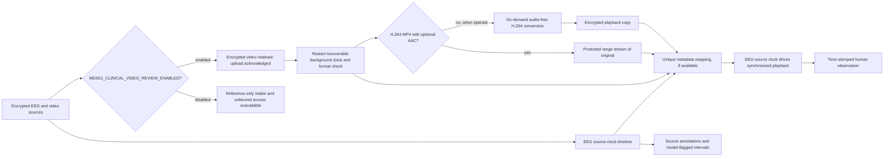

# EEG and VEEG review, explained

MDS01 presents source recordings, imported annotations, and model flags as
separate review evidence. Owner-observation APIs exist, but the current frontend
does not expose annotation entry. EEG and video use independent models; scores are not
combined. A video can be synchronized to an EEG only when the uploaded
recording metadata has one unique mapping and the clinical-video review gate is
enabled. The prototype does not diagnose seizures or infer a brain-onset side
from movement.

## EEG: source recording to review flags

1. The backend encrypts the upload and validates the archive and each supported
   recording.
2. It retains readable source data for owner-only review, then creates a
   separate de-identified model input. Model preprocessing does not alter the
   retained review waveform.
3. The reviewed input contract is 256 Hz, the exact configured 18 bipolar
   channels in contract order, four-second windows with a two-second stride,
   and float32 shape `(N, 1024, 18)`.
4. The H5 runtime checks the local artifact hash and reviewed contract before
   inference. A research threshold flags windows for review; a flagged window
   is not a confirmed seizure and the uncalibrated score is not a probability.
5. Window scores, timestamps, source markers, and safe processing status are
   available to the owner. Original sources, reports, and review results stay
   encrypted until the owner deletes the case. Temporary plaintext and
   processing intermediates are cleaned up after use.

## EEG waveform display

The viewer opens on a fixed 12-second page aligned to the recording timeline.
Previous/next/first-page buttons and the shared review playhead navigate the
full recording; the owner-protected API returns only the visible time range.
There are no montage, sensitivity, paper-speed, or page-length selectors.
Each source trace uses its own timestamps where available, and acquisition gaps
break the line instead of being connected. Model flags and the synchronized
cursor overlay the trace without changing the retained samples.

The fixed profile is **100 µV/cm (10 µV/mm), 30 mm/s, 0.5–70 Hz, and a 50 Hz
notch** for source channels whose native sampling rate supports the filter.
Filtering occurs on the display copy only, separately on contiguous source
segments; it does not alter the model input or retained original. Low-rate
trend channels are left untouched. The responsive browser graticule scales to
fit a 12-second view, so it preserves the configured logical time/voltage
relationship but does not claim to calibrate the physical dimensions of a
particular monitor.

The default longitudinal order is the HUKM layout: right temporal
`FP2-F8 → F8-T4 → T4-T6 → T6-O2`, left temporal
`FP1-F7 → F7-T3 → T3-T5 → T5-O1`, right central
`FP2-F4 → F4-C4 → C4-P4 → P4-O2`, left central
`FP1-F3 → F3-C3 → C3-P3 → P3-O1`, then `FZ-CZ` and `CZ-PZ`. Right chains are
red, left chains blue, midline channels dark, and auxiliaries retain distinct
colors. Each bipolar signal is first electrode minus second electrode. Source
electrodes must be uniquely identified and align within half a sample; historic
T3/T4/T5/T6 aliases map to T7/T8/P7/P8. The UI does not substitute or invent
missing electrodes and labels a partial montage. EOG, ECG/EKG, chin, and
photic channels are retained when available.

The original signal pipeline caused the solid blocks: the legacy Nicolet reader
already applied `dResolution` in µV/count, while the shared API labeled those
values as SI volts. The browser then multiplied them by one million again to
display µV, making normal trace amplitudes millions of times too large. The
`.e` source-preview boundary now converts the parsed µV samples to SI volts
exactly once. EDF dimensions (V, mV, µV, nV) are also normalized to volts;
`.data` values from MNE are already SI volts. The browser then converts these
calibrated values to µV for the fixed profile. Historical normalized/relative
artifacts remain explicitly uncalibrated; unknown EDF physical dimensions fail
closed rather than being guessed.

The source API is bounded to 10,000 points per requested channel range. Screen
diagnostics report sample count, plot-coordinate range, and the percentage
outside the visible canvas. For the supplied 02:00–02:12 `.e` window, the
browser rendered 500 Hz × 12 s = 6,000 samples per 500 Hz channel, all 18
bipolar derivations plus five auxiliary traces, and zero plotted samples
outside the canvas after conversion. The actual browser screenshot is recorded
in the task checkpoint; source timestamps and parser gaps remain the alignment
basis. The supplied Nicolet reference screenshot shows a different interval,
so this check compares channel behavior and layout, not sample-by-sample
waveform equality.

The clinical review emphasizes the event time, recorded EEG, model score and
threshold, source annotations, data-quality state, and corresponding video
when verified coverage exists. It does not treat a score as feature
attribution or clinical cause. Existing explanation artifacts are not a
substitute for interpreting the signal.

## Combined EEG and video review

Generated local setup enables `MDS01_CLINICAL_VIDEO_REVIEW_ENABLED` for
owner-only reference review; a backend with no explicit setting defaults to
`false`. When false, reference-only intake, playback/download, and streaming
are unavailable. Combined intake stores the encrypted original after metadata
validation; it never waits for OpenPose, VSViG, or conversion. A compatible
H.264 MP4 with optional AAC audio streams directly. Unsupported formats are converted only
after the owner opens the clip. A pose failure or unavailable model therefore
does not prevent playback. For a unique mapping, the EEG source clock drives
playback; routine video time updates never reset it. A manual video seek maps
back to EEG time. The player changes clips at verified half-open segment
boundaries and holds the clock while mapped video buffers. During genuine
coverage gaps, the video pauses while the EEG source timeline remains intact.
Outside verified coverage, the interface reports synchronized video as
unavailable.

Matching uses the selected upload folder's metadata, including its opaque
group, filename token HMAC, frame count, frame rate, and VEEG clock anchors.
The group must be finalized with the expected selected files. Only one unique
match is linked. Incomplete folders, missing references, clock/frame
mismatches, ambiguous candidates, and unmatched clips remain unpaired with a
safe reason. A match is evidence that submitted metadata agrees; it is not
proof that the uploaded bytes are the original acquisition. Unmatched clips
remain owner-viewable but are not presented as synchronized.

## Human observation and medical limits

The backend provides owner-scoped endpoints for recording a timestamped
observation interval and encrypts its content separately from model results.
The current frontend does not expose an observation editor. This API feature
does not produce an automatic diagnosis. In the current prototype, the
authenticated owner is the only authorized API user; multi-user clinician
roles are not implemented.

The [ILAE 2025 seizure classification](https://www.ilae.org/files/dmfile/updated-classification-of-epileptic-seizures-2025.pdf)
uses descriptive semiology terms, including side plus body part, eye deviation,
and head orientation. MDS01 records those observations without converting the
movement side into a seizure-onset side. The ILAE Commission on Diagnostic
Methods/EEG Task Force [glossary of seizure semiology terms and their
significance](https://onlinelibrary.wiley.com/doi/full/10.1684/epd.2022.1430)
summarizes sign-specific lateralizing value and the importance of temporal
sequence. Clinical interpretation requires the clinician to consider the
sequence and the EEG/video evidence together; there is no simple body-side to
brain-side rule in this application.

## Separate VSViG video experiment

Standalone video detection runs the pinned Lightweight OpenPose and VSViG
pipeline. It samples 30 frames per model window, using 15 selected pose points
and 15 RGB patches per frame. The adapter's reviewed model tensors have shape
`[B, 30, 15, 3, 32, 32]` for patches and `[B, 30, 15, 3]` for coordinates and
confidence. All 15 selected landmarks must be available for a track in a
scored window; missing points are not synthesized. Multiple tracks are
processed separately, but their labels do not establish which person is the
patient. See the [video runbook](video-detection.md) for the pinned contract
and observed failure cases.

An incomplete-pose or missing-pose result means that no supported model score
was produced for that window. It is not evidence that no seizure occurred.
Successful model loading, a synthetic test, or a high uncalibrated score does
not establish clinical accuracy.

The video upload is encrypted before private-file storage and decrypted only in
the temporary worker workspace. Window scores and Grad-CAM evidence are
compressed and AES-256-GCM encrypted in PostgreSQL, bound to the owner and job
ID; video binaries stay outside the database. The owner-protected results API
returns the validated output for review.

## Run locally

Run `node scripts/demo.mjs` from the repository root to start the H5 research
profile. It requires the local H5 artifact and reviewed contract. Use
`node scripts/demo.mjs --development-stub` only for a synthetic workflow demo;
stub scores are not model analysis. Follow [local setup](setup.md), [system
architecture](architecture.md), and the [backend guide](backend.md) for full
configuration and privacy boundaries.
